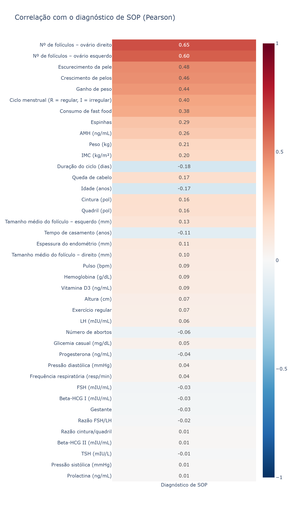

# Síndrome dos Ovários Policísticos (SOP/PCOS): banco relacional e análise exploratória

Trabalho prático de **DCC011 – Introdução a Bancos de Dados** (UFMG). O dataset público de SOP, distribuído como uma única planilha larga, é transformado em um **banco de dados relacional no SQLite**, e a partir dele fazemos uma **análise exploratória** do perfil clínico, hormonal e ultrassonográfico das pacientes.

## Integrantes

- Maria Eduarda Araujo
- Julia Machado
- Luisa Marques
- Mariana Villefort
- Talvani de Souza

## Dados

[*Polycystic ovary syndrome (PCOS)*](https://www.kaggle.com/datasets/prasoonkottarathil/polycystic-ovary-syndrome-pcos), publicado no Kaggle por Prasoon Kottarathil. São **541 mulheres** atendidas em 10 hospitais de Kerala (Índia), **177 com diagnóstico de SOP**, com dados antropométricos, sinais vitais, histórico reprodutivo, 11 exames laboratoriais, sintomas, hábitos e ultrassom dos ovários.

## Modelo relacional

A planilha foi decomposta em 9 tabelas:

| Tabela | Conteúdo |
|---|---|
| `Paciente` | uma linha por paciente (diagnóstico, medidas, sinais vitais, ciclo) |
| `TipoSanguineo` | código → grupo ABO e fator Rh |
| `TipoExame` · `Realiza` | 11 exames e o valor de cada exame por paciente |
| `Sintoma` · `Apresenta` | 5 sintomas e as pacientes que os relataram |
| `Habito` · `Pratica` | 2 hábitos e as pacientes que os praticam |
| `AvaliacaoOvariana` | entidade fraca: folículos de cada ovário (paciente, lado) |

Atributos derivados (IMC e razão cintura/quadril) não são armazenados; ficam na visão `vw_paciente_indices`. Os diagramas ER e relacional estão em [`docs/diagramas.pdf`](docs/diagramas.pdf).

## Estrutura do repositório

```
├── eda_policisticos.ipynb    # ingestão, limpeza, normalização no SQLite e análise exploratória
├── relatorio_parcial.ipynb   # relatório parcial: descrição dos dados, ER e esquema relacional
├── data/                     # dataset original (Kaggle)
├── docs/                     # proposta e diagramas em PDF
└── graficos/
    ├── univariada/           # um histograma por variável
    └── multivariada/         # matriz e vetores de correlação
```

## Como executar

```bash
pip install pandas numpy openpyxl seaborn matplotlib plotly kaleido jupyter
jupyter notebook eda_policisticos.ipynb
```

O notebook cria o banco `pcos.db`, refaz todas as etapas do zero e salva os gráficos em `graficos/`.

## Principais resultados

<p align="center">
  
</p>

- **Marcadores mais associados à SOP:** número de folículos nos ovários (r ≈ 0,65 e 0,60), escurecimento da pele (0,48) e crescimento de pelos (0,47). Eles são manifestações da síndrome e fazem parte dos critérios diagnósticos, não causas.
- **Peso:** pacientes com SOP pesam em média mais (63,0 kg contra 58,0 kg), mas a correlação é fraca (r = 0,21), e a própria síndrome pode levar ao ganho de peso.
- **Possível viés de resposta:** sintomas e hábitos são autodeclarados. O consumo de fast food se correlaciona mais com o número de sintomas relatados (r = 0,50) do que com o IMC (r = 0,16), o que sugere que a associação dos hábitos com a SOP pode estar superestimada.

A discussão completa está na seção de conclusões do [notebook](eda_policisticos.ipynb).
